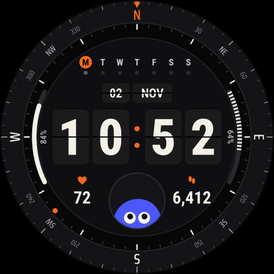

# Flip Fella Watch

Flip Fella for the Samsung Galaxy Watch Ultra, built in Watch Face Format so it shows up in the watch's face picker on One UI 8 Watch (Wear OS 6).

Flip clock cards in the middle, a compass bezel round the edge, battery and steps arcs, heart rate and step counts, a weekday row and Pebble in a little window at the bottom.



## Get the APK

Every push to `main` checks the face against Google's Watch Face Format spec, builds it on GitHub Actions and publishes it as a release. Open the [latest release](../../releases/latest) on your phone and download `flip-fella-watch.apk`.

## Install it on the watch

1. On the watch, turn on **Developer options** (Settings > About watch > Software information, tap Software version seven times).
2. Turn the watch's Bluetooth off so it stays on Wi-Fi, then in Developer options turn on **ADB debugging** and **Wireless debugging**.
3. In Bugjaeger on your phone, pair using the code, IP and port from **Pair new device**. The popup closes by itself when pairing works.
4. Connect using the IP and port on the main Wireless debugging screen (a different port from pairing).
5. In Bugjaeger, install `flip-fella-watch.apk`.
6. Long press the watch face, swipe to the end, tap **Add** and pick **Flip Fella**.
7. Turn Wireless debugging off and Bluetooth back on.

Every build signs with the same key, so new versions install over the top.

## Customising

Long press the face and tap **Customise**. There are five slots:

- **Top shortcut**, just under the N. Empty by default. Put an app shortcut or any complication here.
- **Left arc.** Battery by default. Takes anything with a progress value.
- **Right arc.** Your step goal progress by default (leave it empty for that). Takes anything with a progress value.
- **Left dial.** Heart rate by default (leave it empty for that).
- **Right dial.** Steps by default.

Watch Face Format doesn't let third-party faces read the compass sensor, so the bezel is fixed with north at the top.

## Pebble

- His eyes follow your wrist as you tilt it.
- He blinks when you raise your wrist and when the minute changes.
- Tap him, or wait for the hour, and he bounces.

## Editing the face

The face is generated. Change `tools/generate.py`, then run:

```
python3 tools/generate.py
```

It rewrites `app/src/main/res/raw/watchface.xml`, the images and `tools/out/preview.png`, so you can see the result before pushing.

## Fonts

Roboto Condensed and Saira Condensed, both under the SIL Open Font Licence. Licences are in `licences/`.
